# LAB-006 — Group Policy Management & Workstation Security

## Project Atlas | Hybrid Infrastructure Engineering

**Lab Status:** Technical implementation completed  
**Environment:** Microsoft Azure / Windows Server 2022 / Windows 11  
**Domain:** `corp.atlas.local`  
**Domain Controller:** `DC01`  
**Client Workstation:** `CL01`  
**Group Policy Object:** `ATLAS-Workstation-Security-Baseline`  
**Evidence:** Screenshots 44–64, including 63a–63c

---

## 1. Lab Overview

LAB-006 extends the Active Directory infrastructure established in LAB-001 through LAB-005 by implementing centrally managed workstation security controls using Windows Group Policy.

The exercise focuses on enterprise workstation administration, Group Policy deployment, Microsoft Defender Firewall configuration, secure Remote Desktop access, automatic workstation locking, and Windows Security Event auditing.

Security controls were configured centrally on DC01 and validated on the domain-joined Windows 11 workstation CL01.

The lab also includes troubleshooting of administrative access restrictions and analysis of successful and failed authentication events.

### Objectives

- Validate domain controller and workstation connectivity.
- Inspect the existing Active Directory OU and Group Policy structure.
- Create and link a workstation-specific security baseline GPO.
- Configure Microsoft Defender Firewall profiles.
- Restrict RDP access to the Azure Bastion subnet.
- Validate Group Policy application on CL01.
- Enforce automatic workstation locking after inactivity.
- Configure successful and failed logon auditing.
- Investigate Windows Security Event IDs 4624 and 4625.
- Perform consolidated security validation.
- Document configuration, troubleshooting, results, and supporting evidence.

---

## 2. Infrastructure Architecture

### 2.1 Existing Infrastructure

LAB-006 uses the infrastructure deployed in previous Project Atlas labs.

| Component | Configuration |
|---|---|
| Azure Resource Group | `rg-atlas-lab` |
| Azure Region | West US 2 |
| Virtual Network | `vnet-atlas-lab-us` |
| VNet Address Space | `10.20.0.0/16` |
| Server Subnet | `snet-servers` — `10.20.10.0/24` |
| Client Subnet | `snet-clients` — `10.20.20.0/24` |
| Azure Bastion Subnet | `AzureBastionSubnet` — `10.20.30.0/26` |
| Domain Controller | `DC01` |
| Domain Controller IP | `10.20.10.10` |
| Client Workstation | `CL01` |
| Client IP | `10.20.20.4` |
| Active Directory Domain | `corp.atlas.local` |
| NetBIOS Domain | `CORP` |
| Remote Administration | Azure Bastion |
| Bastion Resource | `bas-atlas-lab-us` |

### 2.2 Active Directory Structure

The workstation security baseline targets the following OU:

```text
corp.atlas.local
└── Atlas
    ├── Computers
    │   ├── Servers
    │   └── Workstations
    │       └── CL01
    ├── Users
    │   ├── IT
    │   ├── Finance
    │   └── HR
    ├── Groups
    └── Service Accounts
```

The workstation security GPO is linked to the **Workstations OU**, rather than the entire domain.

This limits the intended scope of computer-level security controls to workstation computer objects within that OU.

---

## 3. Domain Controller Health Validation

Before implementing Group Policy, the domain controller's core services were checked.

### 3.1 Service Validation

On DC01, PowerShell was used to verify the following services:

```powershell
Get-Service NTDS, DNS, Netlogon
```

### Results

| Service | Result |
|---|---|
| Active Directory Domain Services (NTDS) | Running |
| DNS Server | Running |
| Netlogon | Running |

All three services were operational.

### 3.2 Active Directory Domain Validation

The domain configuration was inspected using:

```powershell
Get-ADDomain
```

Verified properties included:

- Domain: `corp.atlas.local`
- NetBIOS name: `CORP`
- Domain controller: `DC01.corp.atlas.local`
- Domain mode: `Windows2016Domain`

These checks confirmed that the core domain services required for Group Policy deployment were available.

---

## 4. Workstation Connectivity and Initial Group Policy Baseline

CL01 was accessed through Azure Bastion using the domain account:

`alex.morgan@corp.atlas.local`

The following commands were executed:

```powershell
whoami
hostname
nltest /dsgetdc:corp.atlas.local
gpresult /r
```

### Results

- Authenticated user: `CORP\alex.morgan`
- Computer name: `CL01`
- Domain controller: `DC01.corp.atlas.local`
- Domain controller address: `10.20.10.10`
- Domain controller discovery: Successful
- Group Policy source: `DC01.corp.atlas.local`

The initial visible user-side Group Policy results showed no applied user GPOs.

This established a baseline before deploying the workstation security policy.

### Evidence 44 — Initial Domain and Group Policy Baseline

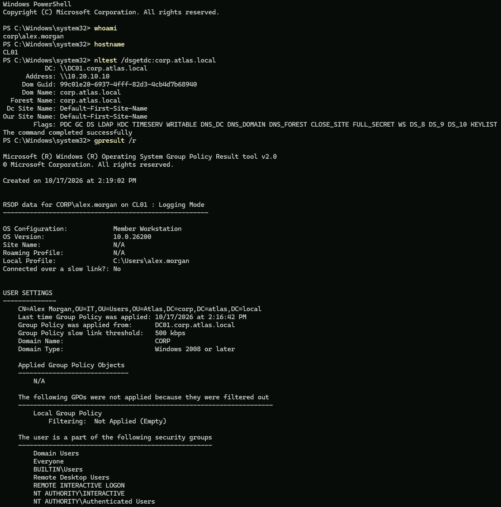

---

## 5. Group Policy Management Console Inspection

Group Policy Management was opened on DC01 using:

```powershell
gpmc.msc
```

The following domain structure was inspected:

```text
Forest: corp.atlas.local
└── Domains
    └── corp.atlas.local
        └── Atlas
            └── Computers
                └── Workstations
```

The **Linked Group Policy Objects** tab for the Workstations OU was initially empty.

This confirmed that no GPOs were directly linked to the OU before the new security baseline was created.

Inherited policies were not assumed to be absent.

### Evidence 45 — Existing GPMC and OU Structure

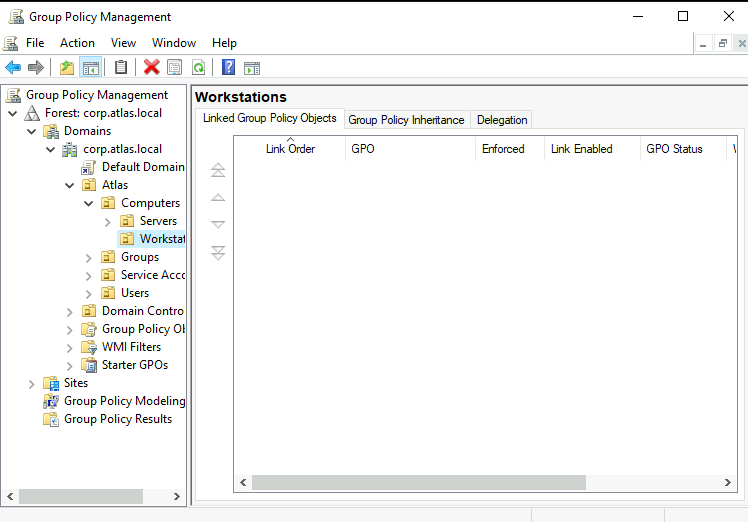

---

## 6. Workstation Security Baseline GPO Deployment

### 6.1 GPO Creation

A new Group Policy Object was created using:

**Workstations OU → Create a GPO in this domain, and Link it here**

The following name was assigned:

`ATLAS-Workstation-Security-Baseline`

No Starter GPO was selected.

### 6.2 GPO Link Configuration

The GPO was linked directly to:

`corp.atlas.local → Atlas → Computers → Workstations`

The configuration was verified in Group Policy Management.

| Property | Verified result |
|---|---|
| Link Order | 1 |
| Link Enabled | Yes |
| Enforced | No |
| GPO Status | Enabled |
| Target OU | Workstations |

The GPO was left unenforced to avoid unnecessarily overriding normal inheritance behaviour.

### Evidence 46 — Workstation Security Baseline GPO

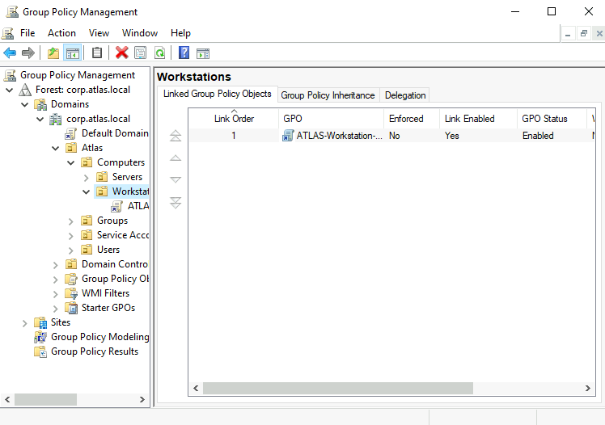

---

## 7. Microsoft Defender Firewall Configuration

### 7.1 Firewall Policy Location

The workstation security GPO was edited through:

```text
Computer Configuration
└── Policies
    └── Windows Settings
        └── Security Settings
            └── Windows Defender Firewall with Advanced Security
                └── Windows Defender Firewall with Advanced Security
```

### 7.2 Firewall Profile Configuration

The Domain, Private, and Public profiles were configured with the following intended settings:

| Setting | Domain | Private | Public |
|---|---|---|---|
| Firewall State | On | On | On |
| Inbound Connections | Block (default) | Block (default) | Block (default) |
| Outbound Connections | Allow (default) | Allow (default) | Allow (default) |

This configuration was designed to enable host-based firewall protection while permitting necessary outbound traffic.

### Evidence 47 — Firewall GPO Configuration

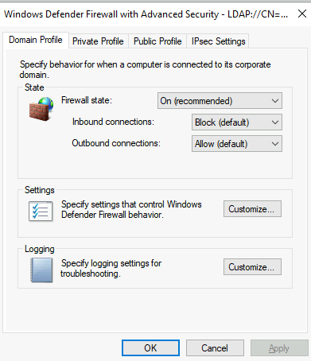

### 7.3 Azure Bastion RDP Allow Rule

To preserve remote administration access, a custom inbound firewall rule was created.

| Property | Configuration |
|---|---|
| Rule Name | `ATLAS-Allow-RDP-From-Bastion` |
| Direction | Inbound |
| Protocol | TCP |
| Local Port | 3389 |
| Action | Allow |
| Profile | Domain |
| Remote Address | `10.20.30.0/26` |

The remote IP scope corresponds to the dedicated Azure Bastion subnet.

This avoids configuring a custom RDP allow rule for unrestricted source addresses.

The rule operates within Windows Defender Firewall and does not require opening TCP 3389 publicly through an Azure Network Security Group.

### Evidence 48 — Bastion RDP Firewall Rule Scope

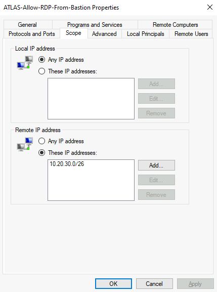

---

## 8. Group Policy Application and Firewall Validation

### 8.1 Refresh Computer Group Policy

On CL01, the computer policy was refreshed:

```powershell
gpupdate /target:computer /force
```

Result:

```text
Computer Policy update has completed successfully.
```

### 8.2 Confirm GPO Application

The following command was executed:

```powershell
gpresult /scope computer /r
```

The Applied Group Policy Objects section included:

```text
ATLAS-Workstation-Security-Baseline
Default Domain Policy
```

The computer account was located in:

```text
CN=CL01,OU=Workstations,OU=Computers,OU=Atlas,DC=corp,DC=atlas,DC=local
```

This confirmed successful computer-level GPO application.

### Evidence 49 — Workstation GPO Application

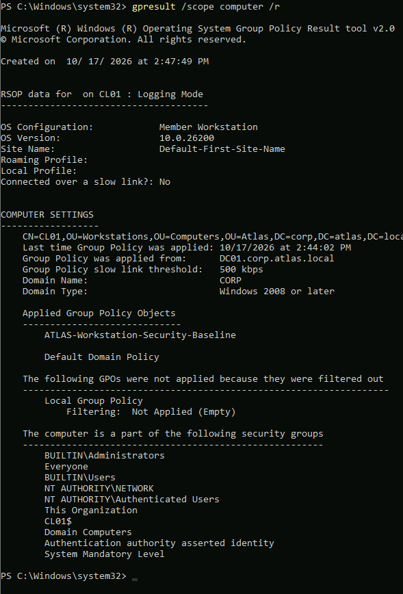

### 8.3 Verify Firewall Rule

The first exact-name query did not return the expected rule.

A subsequent query against the effective firewall policy successfully identified it:

```powershell
Get-NetFirewallRule -PolicyStore ActiveStore |
Where-Object DisplayName -like "*Bastion*" |
Select-Object DisplayName, Enabled, Direction, Action, Profile
```

Verified results:

```text
DisplayName : ATLAS-Allow-RDP-From-Bastion
Enabled     : True
Direction   : Inbound
Action      : Allow
Profile     : Domain
```

### Evidence 50 — Effective RDP Firewall Rule

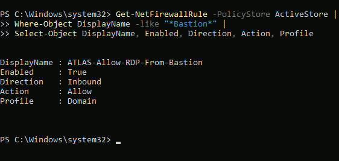

### 8.4 Verify Remote Address Restriction

The remote address filter was inspected:

```powershell
Get-NetFirewallRule -PolicyStore ActiveStore |
Where-Object DisplayName -eq "ATLAS-Allow-RDP-From-Bastion" |
Get-NetFirewallAddressFilter |
Select-Object RemoteAddress
```

Result:

```text
10.20.30.0/255.255.255.192
```

This is equivalent to:

`10.20.30.0/26`

### Evidence 51 — Bastion RDP IP Scope

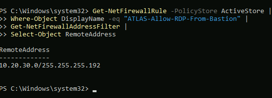

### 8.5 Fresh Bastion Connectivity Test

A new Azure Bastion browser session was opened after the firewall GPO was applied.

The user successfully authenticated to CL01.

The following commands were executed:

```powershell
whoami
hostname
Get-NetConnectionProfile |
Select-Object Name, NetworkCategory
```

Results included:

```text
corp\alex.morgan
CL01
corp.atlas.local    DomainAuthenticated
```

The fresh connection confirmed that the workstation remained remotely accessible after policy deployment.

### Evidence 52 — Bastion Connectivity After Firewall GPO

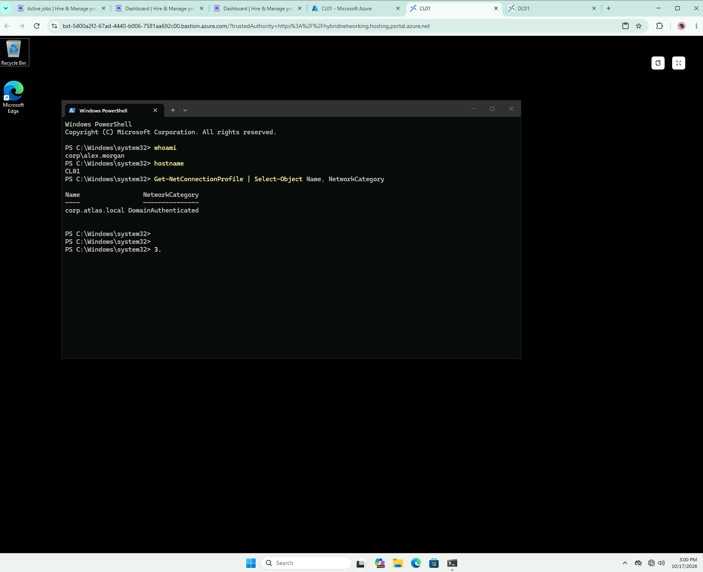

---

## 9. Automatic Workstation Inactivity Lock

### 9.1 Security Objective

An automatic workstation locking policy was configured to reduce the risk of unauthorised access when a workstation is left unattended.

The intended inactivity threshold was **10 minutes**.

### 9.2 GPO Configuration

The following policy was configured:

```text
Computer Configuration
└── Policies
    └── Windows Settings
        └── Security Settings
            └── Local Policies
                └── Security Options
                    └── Interactive logon: Machine inactivity limit
```

Configuration:

| Setting | Value |
|---|---|
| Define this policy setting | Enabled |
| Machine inactivity limit | 600 seconds |
| Equivalent | 10 minutes |

### Evidence 53 — Inactivity Lock Policy Configuration

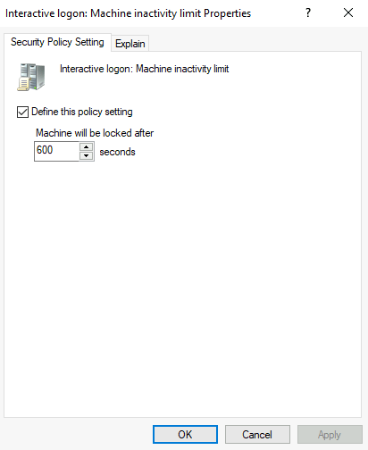

### 9.3 Policy Application and Registry Validation

The GPO was refreshed on CL01:

```powershell
gpupdate /target:computer /force
```

The effective registry setting was checked:

```powershell
Get-ItemProperty `
-Path "HKLM:\SOFTWARE\Microsoft\Windows\CurrentVersion\Policies\System" `
-Name InactivityTimeoutSecs
```

Result:

```text
InactivityTimeoutSecs : 600
```

This confirmed that the configured inactivity threshold had reached CL01.

### Evidence 54 — Inactivity Lock Registry Validation

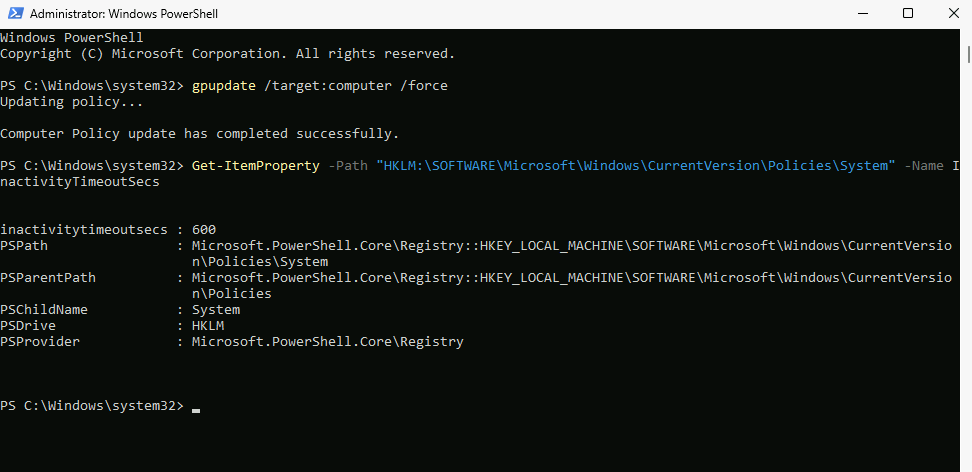

### 9.4 Practical Inactivity Lock Test

A practical test was performed by leaving the CL01 remote session idle for approximately 11–12 minutes.

The workstation subsequently displayed the Windows lock screen.

This demonstrated that the inactivity security control was functioning during the observed test.

### Evidence 55 — Automatic Workstation Lock

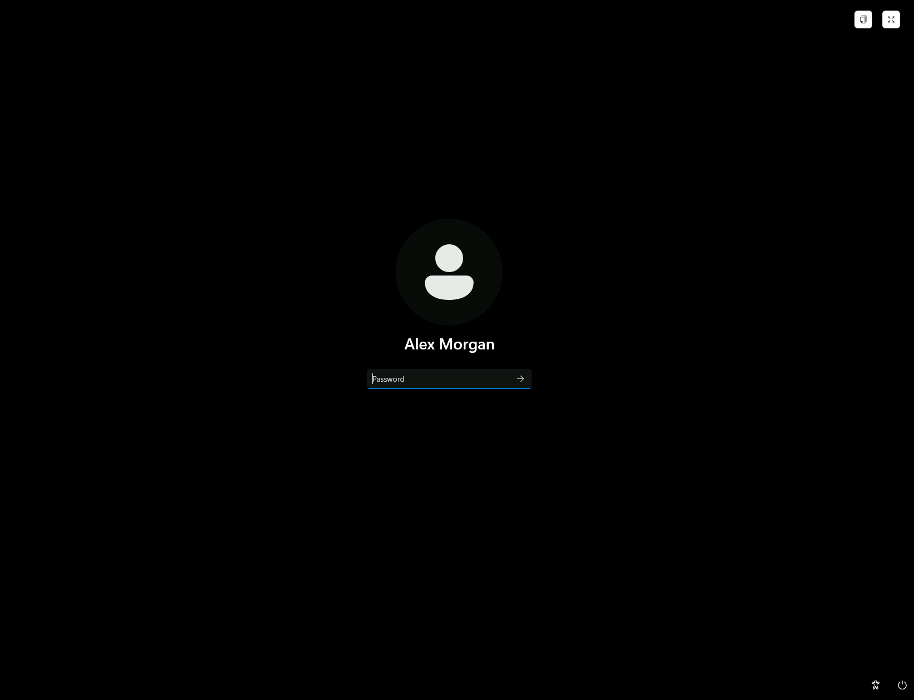

---

## 10. Windows Security Auditing Configuration

### 10.1 Security Objective

Windows Security Auditing was configured to record successful and failed logon attempts.

This supports:

- Authentication troubleshooting.
- Security incident investigation.
- Review of interactive and remote access activity.
- Identification of failed authentication attempts.
- Verification of centrally managed audit policies.

### 10.2 Advanced Audit Policy Configuration

The following Group Policy location was used:

```text
Computer Configuration
└── Policies
    └── Windows Settings
        └── Security Settings
            └── Advanced Audit Policy Configuration
                └── Audit Policies
                    └── Logon/Logoff
                        └── Audit Logon
```

The **Audit Logon** subcategory was configured for:

- Success
- Failure

### Evidence 56 — Logon Auditing GPO Configuration

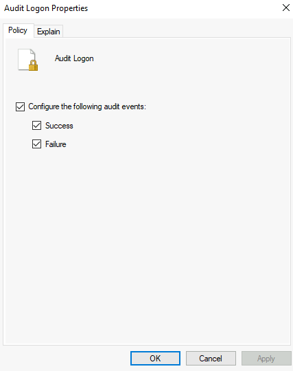

### 10.3 Advanced Audit Policy Precedence

The following setting was enabled:

```text
Computer Configuration
└── Policies
    └── Windows Settings
        └── Security Settings
            └── Local Policies
                └── Security Options
                    └── Audit: Force audit policy subcategory settings
                        to override audit policy category settings
```

This ensures that advanced audit subcategory settings take precedence over legacy audit category settings.

### Evidence 57 — Audit Policy Precedence

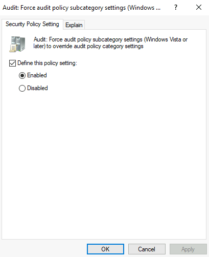

---

## 11. Security Auditing Validation on CL01

### 11.1 Apply Audit Policy

On CL01:

```powershell
gpupdate /target:computer /force
```

### 11.2 Verify Effective Logon Audit Settings

The following command was executed:

```powershell
auditpol /get /subcategory:"Logon"
```

Result:

```text
Category/Subcategory                Setting
Logon/Logoff
  Logon                             Success and Failure
```

This confirmed that successful and failed logon auditing were enabled on CL01.

### Evidence 58 — Effective Logon Audit Policy

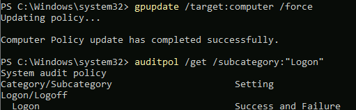

### 11.3 Verify Advanced Audit Policy Precedence

The registry was checked:

```powershell
Get-ItemProperty `
-Path "HKLM:\SYSTEM\CurrentControlSet\Control\Lsa" `
-Name SCENoApplyLegacyAuditPolicy
```

Result:

```text
SCENoApplyLegacyAuditPolicy : 1
```

The computer-level Group Policy results also confirmed that `ATLAS-Workstation-Security-Baseline` was applied.

### Evidence 59 — Audit Policy Precedence Validation

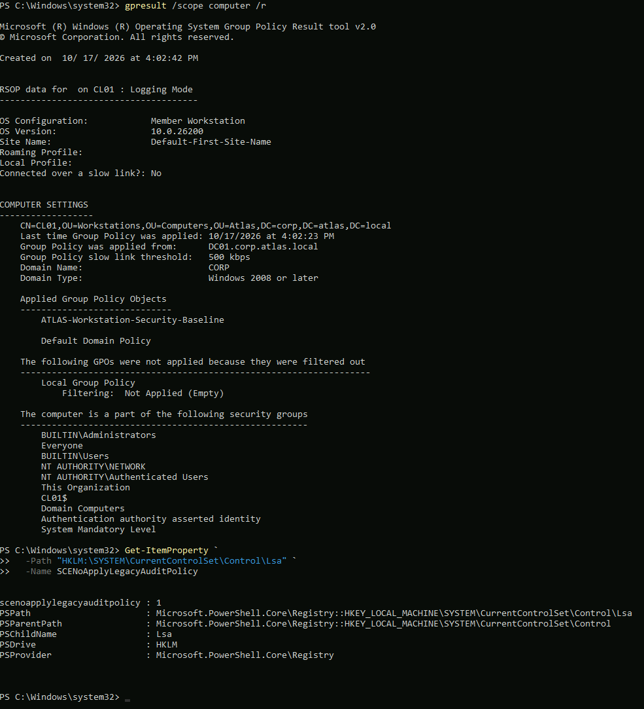

---

## 12. Windows Security Event Investigation

### 12.1 Administrative Access to Security Logs

Windows Event Viewer was opened on CL01 using:

```powershell
eventvwr.msc
```

When initially accessed under the standard domain user session, the Security log returned:

```text
Event Viewer cannot open the event log or custom view.
Access is denied. (5)
```

The issue was resolved by reopening Event Viewer with administrator privileges.

The Security log then became accessible.

This demonstrated the importance of using appropriate administrative permissions for security event investigation.

The standard user account was not added to the local Administrators group.

---

### 12.2 Successful Authentication — Event ID 4624

The Windows Security log was investigated for Event ID:

`4624 — An account was successfully logged on`

A PowerShell query was used to identify events belonging to the domain user:

```powershell
Get-WinEvent -FilterHashtable @{
    LogName = 'Security'
    Id = 4624
    StartTime = (Get-Date).AddDays(-1)
} | Where-Object {
    $_.Properties[5].Value -eq 'alex.morgan'
} | Select-Object TimeCreated, Id,
    @{Name='Username';Expression={$_.Properties[5].Value}},
    @{Name='Domain';Expression={$_.Properties[6].Value}},
    @{Name='LogonType';Expression={$_.Properties[8].Value}} |
Format-Table -AutoSize
```

Six successful authentication events were identified for:

`CORP\alex.morgan`

The results included:

| Time | Event ID | Logon Type |
|---|---|---|
| 4:02:11 PM | 4624 | 7 |
| 3:36:08 PM | 4624 | 10 |
| 3:36:06 PM | 4624 | 3 |
| 2:58:11 PM | 4624 | 10 |
| 2:58:10 PM | 4624 | 3 |
| 2:16:42 PM | 4624 | 10 |

Relevant logon types:

- **Type 3:** Network logon
- **Type 7:** Workstation unlock
- **Type 10:** RemoteInteractive logon, commonly associated with RDP

A successful logon event was inspected in Event Viewer.

Verified event details:

| Field | Value |
|---|---|
| Event ID | 4624 |
| Account | `alex.morgan` |
| Account Domain | `CORP` |
| Computer | `CL01.corp.atlas.local` |
| Timestamp | 17 October 2026, 3:36:08 PM |
| Logon Type | 10, identified through PowerShell |
| Audit Result | Success |

### Evidence 60 — Successful RDP Logon Event

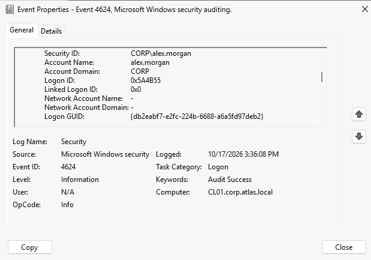

---

### 12.3 Failed Authentication — Event ID 4625

A controlled authentication failure was generated by submitting an incorrect password once through Azure Bastion.

The existing CL01 session was kept open.

The Security log was queried using:

```powershell
Get-WinEvent -FilterHashtable @{
    LogName = 'Security'
    Id = 4625
    StartTime = (Get-Date).AddMinutes(-30)
} | Where-Object {
    $_.Message -match 'alex\.morgan'
} | Select-Object TimeCreated, Id, Message |
Format-List
```

The corresponding Event ID 4625 was successfully identified.

### Observed Event Details

| Field | Result |
|---|---|
| Event ID | 4625 |
| Timestamp | 17 October 2026, 4:23:13 PM |
| Account Name | `alex.morgan@corp.atlas.local` |
| Logon Type | 3 |
| Failure Reason | Unknown user name or bad password |
| Status | `0xC000006D` |
| Substatus | `0xC000006A` |
| Source Network Address | `10.20.30.5` |
| Authentication Package | NTLM |
| Logon Process | NtLmSsp |

### Technical Interpretation

**Event ID 4625** indicates that Windows recorded a failed logon attempt.

**Status `0xC000006D`** indicates a general logon failure.

**Substatus `0xC000006A`** indicates an incorrect password for the account.

**Logon Type 3** indicates a network authentication attempt.

The recorded source address, `10.20.30.5`, falls within the Azure Bastion subnet:

`10.20.30.0/26`

This was consistent with the test being initiated through Azure Bastion.

The event demonstrated that the configured auditing controls could capture failed authentication activity and provide diagnostic information.

### Evidence 61 — Failed Authentication Event

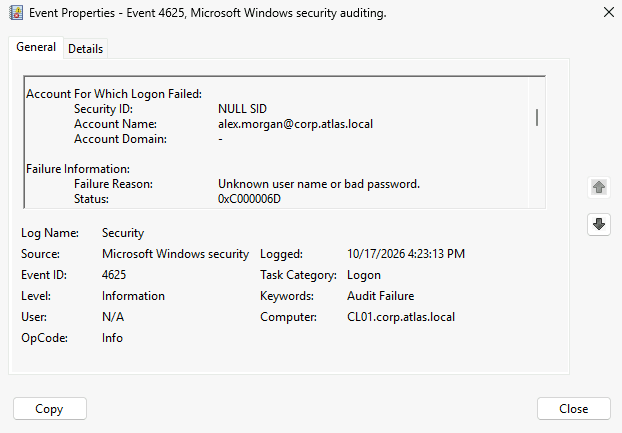

---

## 13. Final Workstation Security Validation

A consolidated validation was performed on CL01 to verify domain connectivity, GPO application, firewall rules, inactivity locking, and auditing.

### 13.1 Domain Controller Discovery

The following commands were executed:

```powershell
whoami
hostname
nltest /dsgetdc:corp.atlas.local
```

Verified results:

- Computer: `CL01`
- Domain controller: `DC01.corp.atlas.local`
- Domain controller IP: `10.20.10.10`
- Domain: `corp.atlas.local`
- Domain controller discovery: Successful

The final administrative PowerShell session was running as:

`CORP\azureuser`

This was appropriate for computer-level policy validation.

### 13.2 Final GPO Application

The following command was executed:

```powershell
gpresult /scope computer /r
```

The applied computer GPOs included:

```text
ATLAS-Workstation-Security-Baseline
Default Domain Policy
```

### Evidence 62 — Final Domain and GPO Validation

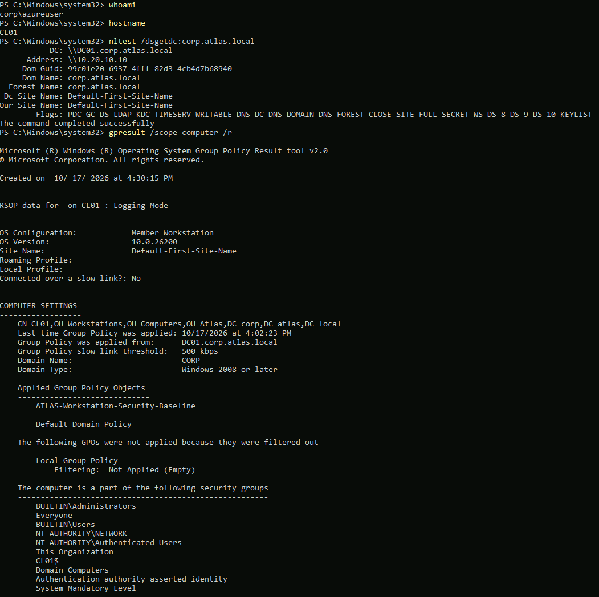

### 13.3 Final Firewall Profile Validation

The following command was executed:

```powershell
Get-NetFirewallProfile |
Select-Object Name, Enabled, DefaultInboundAction, DefaultOutboundAction
```

Observed results:

| Profile | Enabled | DefaultInboundAction | DefaultOutboundAction |
|---|---|---|---|
| Domain | True | NotConfigured | NotConfigured |
| Private | True | NotConfigured | NotConfigured |
| Public | True | NotConfigured | NotConfigured |

All three firewall profiles were enabled.

The `NotConfigured` values were recorded as observed and were not interpreted as proof of a particular effective traffic action.

### Evidence 63a — Firewall Profiles

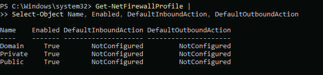

### 13.4 Final RDP Firewall Rule Validation

The following command was executed:

```powershell
Get-NetFirewallRule -PolicyStore ActiveStore |
Where-Object DisplayName -eq "ATLAS-Allow-RDP-From-Bastion" |
Select-Object DisplayName, Enabled, Direction, Action, Profile
```

Result:

```text
DisplayName : ATLAS-Allow-RDP-From-Bastion
Enabled     : True
Direction   : Inbound
Action      : Allow
Profile     : Domain
```

### Evidence 63b — RDP Firewall Rule

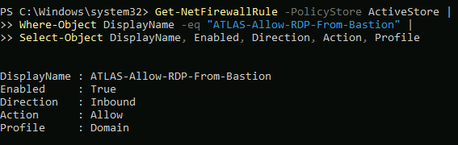

### 13.5 Final RDP Source Restriction Validation

The following command was executed:

```powershell
Get-NetFirewallRule -PolicyStore ActiveStore |
Where-Object DisplayName -eq "ATLAS-Allow-RDP-From-Bastion" |
Get-NetFirewallAddressFilter |
Select-Object RemoteAddress
```

Result:

```text
10.20.30.0/255.255.255.192
```

Equivalent CIDR:

`10.20.30.0/26`

### Evidence 63c — RDP Source Restriction

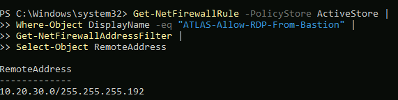

### 13.6 Final Inactivity Lock and Auditing Validation

The following commands were executed:

```powershell
Get-ItemPropertyValue `
-Path "HKLM:\SOFTWARE\Microsoft\Windows\CurrentVersion\Policies\System" `
-Name InactivityTimeoutSecs
```

Result:

```text
600
```

```powershell
auditpol /get /subcategory:"Logon"
```

Result:

```text
Logon    Success and Failure
```

```powershell
Get-ItemPropertyValue `
-Path "HKLM:\SYSTEM\CurrentControlSet\Control\Lsa" `
-Name SCENoApplyLegacyAuditPolicy
```

Result:

```text
1
```

These results confirmed that the workstation retained the intended inactivity timeout and effective logon auditing configuration.

### Evidence 64 — Final Workstation Security Validation

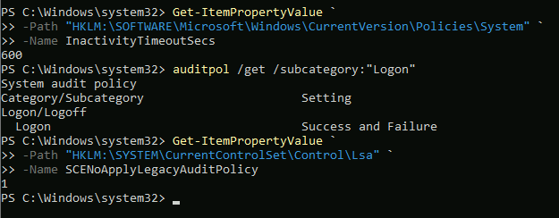

---

## 14. Troubleshooting and Resolutions

The following issues were encountered and investigated during LAB-006.

| Issue | Investigation | Resolution / Finding |
|---|---|---|
| Native RDP connection to DC01 failed | TCP 3389 inaccessible from external source | Used existing Azure Bastion connectivity without opening public RDP access |
| Custom Bastion firewall rule initially not found | Exact-name PowerShell query returned no matching rule | Queried ActiveStore using a wildcard and confirmed the effective rule |
| Firewall default actions showed `NotConfigured` | Reviewed `Get-NetFirewallProfile` output | Confirmed firewall profiles enabled; did not assume effective traffic defaults |
| Security log returned Access Denied (5) | Event Viewer opened under standard user context | Reopened Event Viewer with administrator privileges |
| Alex Morgan's 4624 event was difficult to locate | Security log contained many events | Used PowerShell filtering to identify matching username and logon type |
| Failed Bastion authentication required investigation | Queried recent Event ID 4625 records | Identified incorrect-password failure and Bastion subnet source address |

These troubleshooting activities demonstrate systematic investigation rather than reliance on assumptions about policy deployment or authentication behaviour.

---

## 15. Evidence Register

All LAB-006 evidence is stored under:

`evidence/lab-006/`

| ID | Evidence File | Description |
|---|---|---|
| 44 | `44-cl01-domain-connectivity-gpo-baseline.png` | Initial CL01 domain and Group Policy baseline |
| 45 | `45-gpmc-existing-domain-ou-structure.png` | Existing GPMC and Workstations OU structure |
| 46 | `46-workstation-security-baseline-gpo-created.png` | Workstation security GPO creation and link |
| 47 | `47-workstation-firewall-gpo-configuration.png` | Firewall profile GPO configuration |
| 48 | `48-bastion-rdp-firewall-rule-scope.png` | Bastion RDP firewall rule scope |
| 49 | `49-cl01-gpo-application-validation.png` | Computer-level GPO application |
| 50 | `50-cl01-firewall-rule-validation.png` | Effective Bastion firewall rule |
| 51 | `51-cl01-bastion-rdp-ip-scope-validation.png` | Bastion subnet source restriction |
| 52 | `52-cl01-bastion-connectivity-after-firewall-gpo.png` | Successful fresh Bastion connection |
| 53 | `53-workstation-inactivity-lock-gpo-configuration.png` | Machine inactivity policy |
| 54 | `54-cl01-inactivity-lock-policy-validation.png` | Registry confirmation of inactivity timeout |
| 55 | `55-cl01-automatic-inactivity-lock-validation.png` | Practical workstation lock test |
| 56 | `56-workstation-logon-auditing-gpo-configuration.png` | Audit Logon GPO configuration |
| 57 | `57-advanced-audit-policy-precedence-configuration.png` | Advanced audit policy precedence |
| 58 | `58-cl01-logon-audit-policy-validation.png` | Effective Success and Failure auditing |
| 59 | `59-cl01-advanced-audit-policy-precedence-validation.png` | Registry validation of audit precedence |
| 60 | `60-cl01-successful-logon-event-4624.png` | Successful domain-user logon |
| 61 | `61-cl01-failed-logon-event-4625.png` | Failed authentication investigation |
| 62 | `62-cl01-final-domain-gpo-validation.png` | Final domain and GPO validation |
| 63a | `63a-cl01-final-firewall-profiles.png` | Final firewall profile status |
| 63b | `63b-cl01-final-rdp-firewall-rule.png` | Final RDP firewall rule |
| 63c | `63c-cl01-final-rdp-source-restriction.png` | Final Bastion subnet restriction |
| 64 | `64-cl01-final-workstation-security-validation.png` | Final inactivity and audit controls |

Evidence files should retain their exact names so that relative Markdown image references render correctly on GitHub.

---

## 16. Skills Demonstrated

### Active Directory and Group Policy

- Group Policy Management Console administration.
- Organisational Unit-based policy targeting.
- Computer-level GPO deployment and verification.
- Group Policy Resultant Set of Policy investigation.
- Domain controller discovery and connectivity validation.

### Windows Workstation Security

- Microsoft Defender Firewall configuration.
- Inbound RDP firewall rule management.
- Remote IP address restrictions.
- Automatic workstation inactivity locking.
- Security baseline deployment.

### Security Monitoring and Auditing

- Advanced Audit Policy Configuration.
- Windows Security Event Viewer administration.
- Successful logon event investigation.
- Failed authentication event investigation.
- Windows authentication status code interpretation.
- Source IP and logon type analysis.

### PowerShell and Troubleshooting

- `gpupdate`
- `gpresult`
- `Get-NetFirewallProfile`
- `Get-NetFirewallRule`
- `Get-NetFirewallAddressFilter`
- `Get-NetConnectionProfile`
- `auditpol`
- `Get-WinEvent`
- `Get-ItemProperty`
- `Get-ItemPropertyValue`
- `nltest`

---

## 17. Final Outcome

LAB-006 successfully demonstrated the implementation and validation of centrally managed workstation security controls within the Project Atlas Active Directory environment.

The following outcomes were achieved:

1. DC01 domain services were validated as operational.
2. CL01 domain connectivity and computer-level Group Policy processing were confirmed.
3. A dedicated workstation security baseline GPO was created and linked to the Workstations OU.
4. Microsoft Defender Firewall was enabled across Domain, Private, and Public profiles.
5. A custom inbound RDP rule was deployed and restricted to the Azure Bastion subnet.
6. A fresh Bastion connection to CL01 succeeded following firewall policy deployment.
7. A 600-second inactivity limit was deployed and verified.
8. CL01 was observed automatically locking after the inactivity test.
9. Success and Failure logon auditing was enabled and validated.
10. Successful RDP logon events were identified using Event ID 4624.
11. A controlled failed authentication was recorded and investigated using Event ID 4625.
12. Final domain, Group Policy, firewall, RDP, inactivity, and audit configuration checks were completed.

The lab provides practical evidence of Windows enterprise administration, endpoint security configuration, Group Policy troubleshooting, and security event investigation.

**LAB-006 Status: Technical implementation completed.**

---

## 18. Next Lab

**LAB-007 — Windows Server File Services, NTFS Permissions & SMB Shares**

The next lab will extend Project Atlas into enterprise file services, shared folder administration, NTFS permissions, access control, and domain-based resource access validation.
